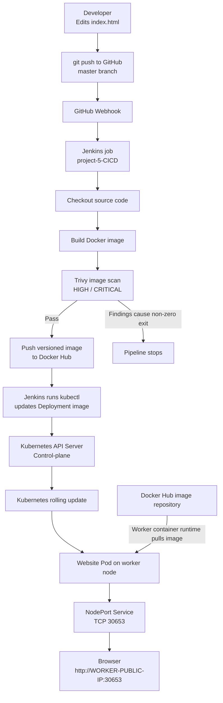
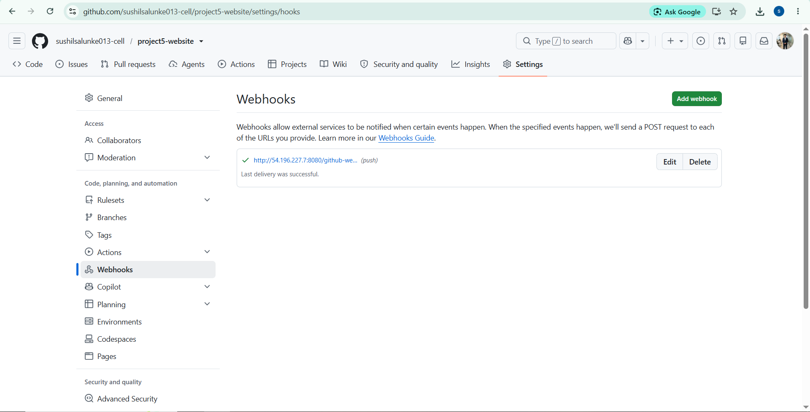
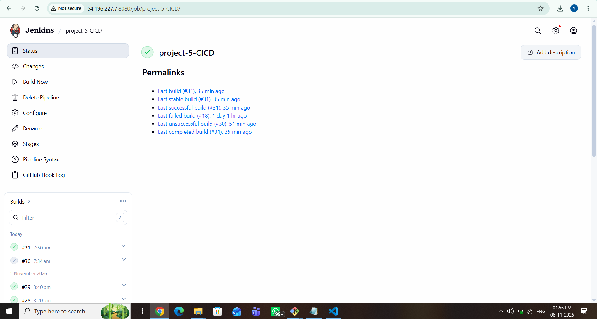
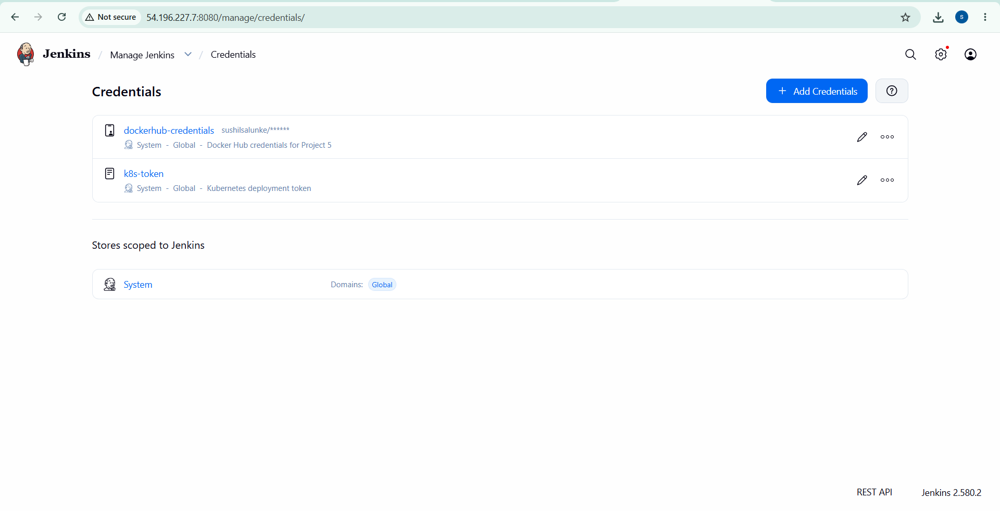
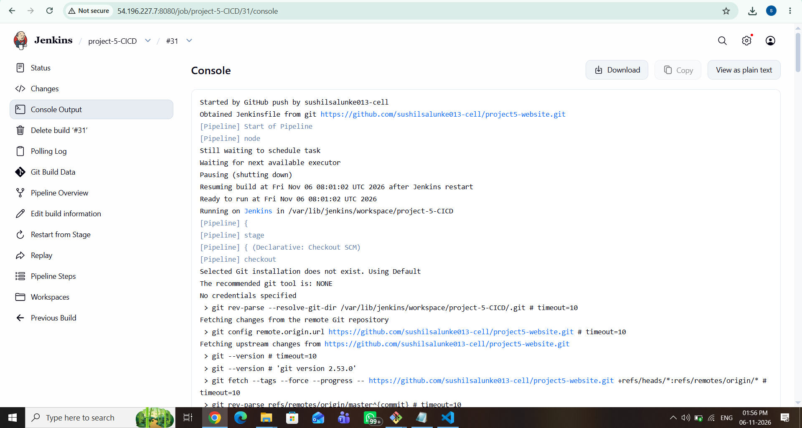
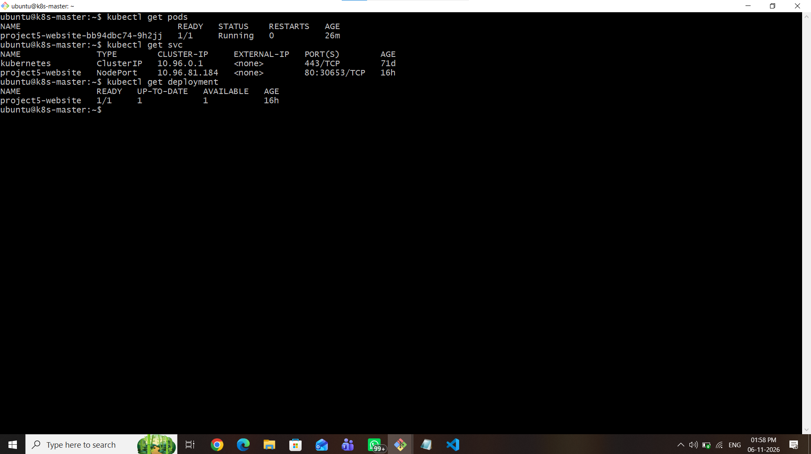
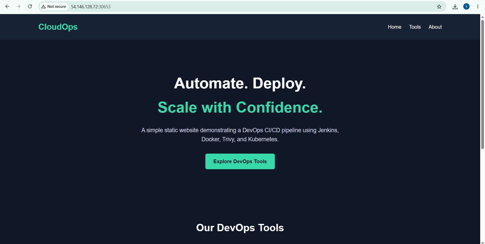
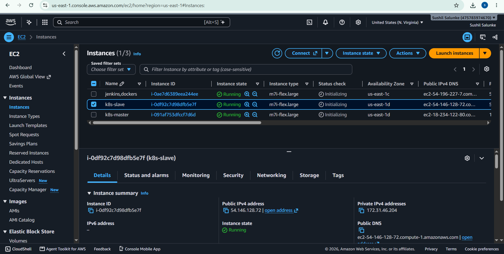
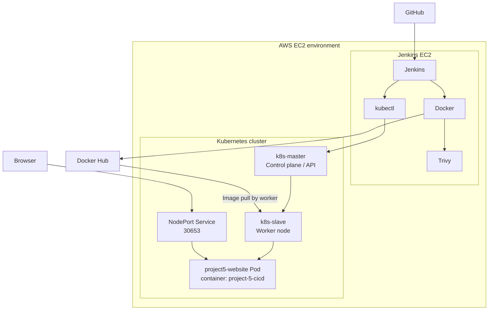

# Project 5 — Automated CI/CD Pipeline for a Static Website

**A beginner-friendly DevOps project using GitHub, Jenkins, Docker, Trivy, Docker Hub, Kubernetes and AWS EC2.**

- **GitHub repository:** https://github.com/sushilsalunke013-cell/project5-website
- **Docker Hub repository:** `sushilsalunke/project-5-cicd`
- **Jenkins job:** `project-5-CICD`
- **Kubernetes Deployment:** `project5-website`
- **Kubernetes Service:** `project5-website`
- **Website NodePort:** `30653`

> This README documents the implementation and screenshots supplied for this project. IP addresses are intentionally represented as placeholders because EC2 public IPs can change. Do not add passwords, tokens, private keys or other secrets to this repository.

---

## 1. What does this project do?

This project automatically deploys a static website to Kubernetes whenever code is pushed to GitHub.

In simple terms:

1. We update the website code and push it to GitHub.
2. GitHub sends a webhook notification to Jenkins.
3. Jenkins downloads the latest code.
4. Jenkins builds a Docker image.
5. Trivy scans the image for security vulnerabilities.
6. Jenkins pushes the image to Docker Hub.
7. Jenkins tells Kubernetes to use the new image.
8. Kubernetes starts the updated website container.
9. We open the website in a browser using the worker EC2 public IP and NodePort `30653`.

This is the complete CI/CD flow: **Continuous Integration (build and scan) + Continuous Deployment (deploy to Kubernetes).**

---

## 2. Architecture diagram

The diagram below shows the actual logical flow used in this project.



### Architecture explained

| Component | What it does |
|---|---|
| Developer | Makes changes to the website files |
| GitHub | Stores the source code |
| GitHub Webhook | Notifies Jenkins when code is pushed |
| Jenkins | Runs the automated pipeline |
| Docker | Packages the website into an image |
| Trivy | Scans the image for vulnerabilities |
| Docker Hub | Stores the versioned Docker image |
| Kubernetes API Server | Receives deployment changes from Jenkins |
| Kubernetes Deployment | Manages the desired Pod replicas and updates |
| Worker node | Runs the website Pod and pulls its image |
| NodePort Service | Makes the website reachable on port `30653` |

**Important image-pull detail:** Jenkins sends the deployment update to the Kubernetes API Server. Kubernetes schedules the Pod, and the worker node's container runtime pulls the requested image from Docker Hub. Docker Hub does not contact the cluster to deploy the application.

---

## 3. Technologies used

| Technology | Why we used it |
|---|---|
| AWS EC2 | Virtual machines for Jenkins and Kubernetes |
| Git | Version control |
| GitHub | Source-code repository |
| GitHub Webhook | Automatic Jenkins trigger |
| Jenkins | CI/CD automation |
| Docker | Container image creation |
| Trivy | Container image security scanning |
| Docker Hub | Image registry |
| Kubernetes | Container orchestration and deployment |
| kubectl | Command-line tool to manage Kubernetes |

---

## 4. Project structure

The repository should contain the website source and the pipeline file. The screenshots folder below contains the evidence supplied for this README.

```text
project5-website/
├── index.html
├── Dockerfile
├── Jenkinsfile
├── README.md
└── screenshots/
    ├── 01-jenkins-credentials.png
    ├── 02-jenkins-job-dashboard.png
    ├── 03-jenkins-build-31-console.png
    ├── 04-github-webhook.png
    ├── 05-aws-ec2-instances.png
    ├── 06-website-nodeport.png
    ├── 07-kubernetes-pods-service-deployment.png
    └── 08-jenkins-service-status.png
```

If your actual repository uses a different filename or additional files, keep the README tree consistent with the files you really commit.

---

## 5. Step-by-step project workflow

### Step 1 — Create and push the website code to GitHub

The website source is stored in:

`https://github.com/sushilsalunke013-cell/project5-website`

The Jenkins job is configured to build the `master` branch.

Example Git commands:

```bash
git add .
git commit -m "Update website"
git push origin master
```

**What happens?** Git records the change and sends it to the GitHub repository.

### Step 2 — Configure GitHub Webhook

A webhook is configured in the repository settings. It sends a push event to Jenkins.

**What happens?**

- A developer pushes a commit.
- GitHub sends an HTTP POST webhook event to Jenkins.
- Jenkins receives the event and starts the configured job.



The screenshot shows a successful recent webhook delivery. Do not publish webhook secrets.

### Step 3 — Jenkins starts the pipeline

The Jenkins job name is:

```text
project-5-CICD
```

The Jenkins dashboard screenshot shows build **#31** as the last successful build at the time of capture.



### Step 4 — Jenkins uses stored credentials

Jenkins stores the credentials needed to push to Docker Hub and deploy to Kubernetes.

| Jenkins credential ID | Purpose |
|---|---|
| `dockerhub-credentials` | Docker Hub authentication |
| `k8s-token` | Kubernetes ServiceAccount token |



The screenshot shows credential IDs and masked Docker Hub information. Never reveal or commit the actual passwords, access tokens, Kubernetes tokens or private keys.

### Step 5 — Jenkins checks out the source code

Jenkins obtains the `Jenkinsfile` and application source from the GitHub repository.

The build console shows that the job was started by a GitHub push and that Jenkins obtained the Jenkinsfile from the project repository.



The console screenshot is captured near the beginning of the build log; use the Jenkins build page's final status and the job dashboard to show the successful result.

### Step 6 — Build the Docker image

Jenkins builds the website into a Docker image.

The local image name used by the pipeline is:

```text
cloudops-static-site:1.0
```

The image is tagged for Docker Hub with the Jenkins build number:

```text
sushilsalunke/project-5-cicd:1.0-${BUILD_NUMBER}
```

For example, build number 31 corresponds to:

```text
sushilsalunke/project-5-cicd:1.0-31
```

**Why use a build number?** It gives each pipeline build its own tag, so we can identify which image version was produced by that build.

### Step 7 — Scan the image with Trivy

The pipeline scans the local image with:

```bash
trivy image --severity HIGH,CRITICAL --exit-code 1 cloudops-static-site:1.0
```

Meaning of the options:

- `image` — scan a container image.
- `--severity HIGH,CRITICAL` — select HIGH and CRITICAL severity vulnerabilities.
- `--exit-code 1` — return exit code 1 when selected-severity findings are detected.
- `cloudops-static-site:1.0` — the local image being scanned.

**Pipeline behavior:** If Trivy finds HIGH or CRITICAL vulnerabilities, this command returns a failure code. In a Jenkins pipeline, that normally stops the later push and deployment stages unless the Jenkinsfile handles the failure differently.

**Important scan note:** The Trivy output supplied with this project includes HIGH-severity findings for packages such as `curl` and `libexpat`. Therefore, this README does **not** claim that the image is vulnerability-free. The scan output must be reviewed and the image/base packages updated, then scanned again. The successful Jenkins job screenshot alone does not prove that a separate manual scan had zero findings or that the pipeline used the same image and scan result.

Suggested remediation cycle:

1. Identify the affected package and fixed version in the Trivy output.
2. Update the Docker base image or affected package.
3. Rebuild the image.
4. Run Trivy again.
5. Confirm that the findings are resolved or formally assessed before publishing.

### Step 8 — Push the image to Docker Hub

After the scan stage passes, Jenkins logs in using the credential ID `dockerhub-credentials` and pushes the versioned image to:

```text
sushilsalunke/project-5-cicd
```

The image tag is based on the Jenkins build number, for example `1.0-31`.

Docker Hub is the image registry. It stores the image so the Kubernetes worker node can pull it when a Pod is created.

### Step 9 — Jenkins updates Kubernetes

Jenkins uses `kubectl` to contact the Kubernetes API Server over HTTPS.

The project configuration recorded during implementation:

| Setting | Value |
|---|---|
| ServiceAccount | `jenkins-deployer` |
| Jenkins token credential ID | `k8s-token` |
| Namespace used for application deployment | `default` |
| Deployment name | `project5-website` |
| Container name in Deployment | `project-5-cicd` |
| Kubernetes API port | `6443` |
| CA certificate path on Jenkins | `/tmp/ca.crt` |

The API server private IP and certificate are environment-specific. Do not assume the old IP remains correct if the cluster is recreated.

The deployment command is equivalent to the following example (the tag is illustrative):

```bash
kubectl \
  --server=https://<KUBERNETES-API-PRIVATE-IP>:6443 \
  --certificate-authority=/tmp/ca.crt \
  --token="$K8S_TOKEN" \
  set image deployment/project5-website \
  project-5-cicd=sushilsalunke/project-5-cicd:1.0-31 \
  -n default
```

In the Jenkinsfile, the token is injected from Jenkins Credentials and the image tag is generated from the current build number. The token should never be hard-coded or printed.

### Step 10 — Kubernetes performs a rolling update

When the Deployment image is changed, Kubernetes creates a Pod using the new image and replaces the previous Pod according to the Deployment update strategy.

Check the rollout:

```bash
kubectl rollout status deployment/project5-website \
  --timeout=180s \
  -n default
```

### Step 11 — Access the website through NodePort

The application is exposed using a Kubernetes NodePort Service.

The captured Service output shows:

- Service type: `NodePort`
- Service port: `80`
- NodePort: `30653`
- Pod: `1/1 Running`
- Deployment: `1/1` ready



The website is opened using the worker EC2 public IP and NodePort:

```text
http://<WORKER-PUBLIC-IP>:30653
```

The supplied screenshot shows the website successfully loaded through the worker public IP on port `30653`.



The worker EC2 Security Group must allow inbound TCP port `30653` from the intended client IP/network. Prefer restricting the source to your own IP rather than allowing access from everywhere.

---

## 6. AWS EC2 infrastructure

The supplied AWS screenshot shows three running EC2 instances:

- `jenkins,dockers` — Jenkins/CI server.
- `k8s-master` — Kubernetes control-plane node.
- `k8s-slave` — Kubernetes worker node.



The public IP addresses shown in the AWS console are changeable infrastructure details. Use the current instance addresses when connecting; do not treat a screenshot IP as permanent.

### High-level infrastructure flow



---

## 7. Useful commands

Run Kubernetes commands on the master/control-plane node or another machine with a valid kubeconfig.

### Check Kubernetes nodes

```bash
kubectl get nodes -o wide
```

### Check Pods

```bash
kubectl get pods -o wide
```

### Check Deployments

```bash
kubectl get deployments
kubectl describe deployment project5-website
```

### Check Services and NodePort

```bash
kubectl get services
kubectl describe service project5-website
```

### Check the image currently configured in the Deployment

```bash
kubectl get deployment project5-website \
  -o jsonpath='{.spec.template.spec.containers[*].image}'
echo
```

### Check rollout status

```bash
kubectl rollout status deployment/project5-website
```

### View Pod logs

```bash
kubectl get pods
kubectl logs <POD-NAME>
```

### Inspect a Pod if it fails

```bash
kubectl describe pod <POD-NAME>
```

### Check Jenkins ServiceAccount and RBAC objects

```bash
kubectl get serviceaccounts -n jenkins
kubectl get roles,rolebindings -n jenkins
```

---

## 8. Network ports used

| Source | Destination | Port | Reason |
|---|---|---:|---|
| Browser / webhook sender | Jenkins EC2 | TCP 8080 | Jenkins UI and webhook endpoint |
| Jenkins EC2 | GitHub | TCP 443 | Source checkout |
| Jenkins EC2 | Docker Hub | TCP 443 | Push container image |
| Jenkins EC2 | Kubernetes API | TCP 6443 | Update Kubernetes Deployment |
| Kubernetes worker | Docker Hub | TCP 443 | Pull container image |
| Browser | Kubernetes worker EC2 | TCP 30653 | Open the website |

Configure AWS Security Groups to permit only the traffic needed. Avoid exposing Jenkins and the Kubernetes API publicly to unrestricted sources.

---

## 9. How to test the complete CI/CD pipeline

This test proves that the project is automated.

1. Change a visible heading or paragraph in `index.html`.
2. Commit and push the change to the `master` branch.
3. Confirm GitHub reports a successful webhook delivery.
4. Confirm Jenkins starts a new build of `project-5-CICD`.
5. Check each pipeline stage: checkout, build, Trivy scan, Docker Hub push and Kubernetes deployment.
6. Confirm a new build-number image tag is published to Docker Hub.
7. On the Kubernetes master, run:

```bash

kubectl get pods -o wide

kubectl rollout status deployment/project5-website
```

8. Refresh `http://<WORKER-PUBLIC-IP>:30653` and confirm the website shows the new content.

---

## 10. Troubleshooting

### GitHub push does not start Jenkins

- Check that the webhook URL points to the current Jenkins public address.
- Check that Jenkins is reachable on TCP `8080`.
- Review webhook delivery status in GitHub.
- Confirm the Jenkins job is configured to respond to GitHub push events.

### Docker Hub push fails

- Confirm the Jenkins credential ID `dockerhub-credentials` exists.
- Confirm the Docker Hub repository name is correct.
- Check that the credential has permission to push to that repository.

### Trivy reports HIGH or CRITICAL vulnerabilities

- Read the package name, CVE, installed version and fixed version.
- Update the base image or vulnerable package.
- Rebuild and rescan the image.
- Do not describe an image as clean while unresolved HIGH/CRITICAL findings remain.

### Jenkins cannot connect to Kubernetes

- Verify the API server's current private IP and TCP `6443` connectivity.
- Verify `/tmp/ca.crt` is the correct cluster CA certificate.
- Verify the `k8s-token` credential contains a valid, unexpired token.
- Check that the ServiceAccount has the required permissions in the target namespace.

### Kubernetes cannot pull an image

- Check the image repository and tag in the Deployment.
- Confirm that the tag exists in Docker Hub.
- Check worker-node outbound access to Docker Hub.
- Inspect events using `kubectl describe pod <POD-NAME>`.

### Website does not open

```bash
kubectl get pods -o wide
kubectl get service project5-website
```

- Confirm the Pod is ready.
- Confirm NodePort is `30653`.
- Confirm inbound TCP `30653` is allowed in the worker EC2 Security Group.
- Use the worker's current public IP address.

### Jenkins EC2 disk space is low

```bash
df -h
```

Docker image layers and Trivy vulnerability databases can use substantial disk space. Inspect disk usage before cleanup. Increase the EBS volume when required. Do not casually delete Jenkins jobs, credentials or plugins.

---

## 11. Security notes and future improvements

This is a hands-on learning project. Before using a similar design in production:

- Apply least-privilege Kubernetes RBAC permissions.
- Use short-lived credentials or a managed secret solution where possible.
- Keep tokens, passwords and private keys in Jenkins Credentials or a secret manager.
- Restrict Jenkins, SSH, Kubernetes API and NodePort access to trusted networks.
- Use TLS and a controlled Ingress/load balancer instead of exposing NodePort directly.
- Add readiness and liveness probes, CPU/memory requests and limits.
- Add a documented rollback strategy.
- Consider image digests, image signing and provenance verification.
- Add monitoring, centralized logs and backups.
- Regularly update base images, dependencies, Jenkins plugins, Trivy and Kubernetes.

---

## 12. What I learned

By completing this project, I practised:

- Git and GitHub source-code management.
- GitHub webhook integration with Jenkins.
- Jenkins pipeline stages.
- Docker image build and tagging.
- Container image security scanning with Trivy.
- Jenkins Credentials management.
- Publishing images to Docker Hub.
- Kubernetes Pods, Deployments and Services.
- Kubernetes ServiceAccounts, Roles and RoleBindings.
- Updating a Deployment using `kubectl`.
- Monitoring rollout status.
- AWS EC2 networking and Security Groups.
- Troubleshooting CI/CD and Kubernetes deployment issues.

---

## 13. Final result

The project connects GitHub, Jenkins, Docker, Trivy, Docker Hub and Kubernetes into one automated workflow. A code push triggers Jenkins; Jenkins builds and scans an image, publishes it to Docker Hub, and updates the Kubernetes Deployment. Kubernetes runs the website Pod, and the website is available through the worker EC2 public IP on NodePort `30653`.

The Jenkins job page screenshot records build **#31** as successful. The separate Trivy output supplied with the project contains HIGH-severity package findings, so those findings should be reviewed and remediated before describing the image as vulnerability-free.

---

## Author

- **GitHub profile:** https://github.com/sushilsalunke013-cell
- **Project repository:** https://github.com/sushilsalunke013-cell/project5-website
- **Docker Hub repository:** `sushilsalunke/project-5-cicd`
